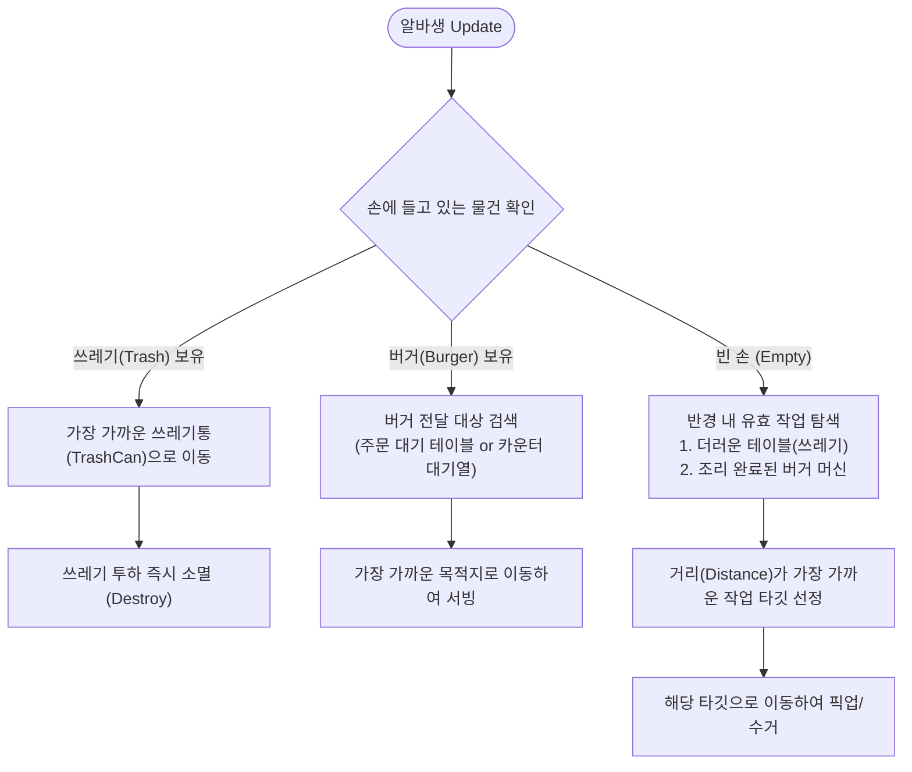
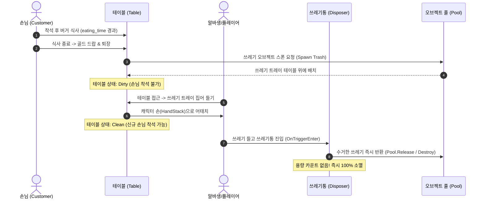
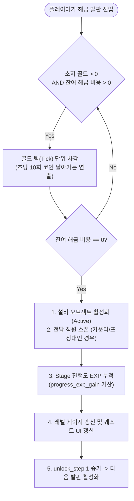

# 🍔 [시스템/데이터 명세서] 버거 매장 풀해금 데이터 & 인게임 시스템 연동 가이드

> **문서 버전**: v1.0.0  
> **대상 타깃**: 기획자 및 클라이언트 시스템 개발자 / AI 에이전트  
> **적용 프로젝트**: `DBRead` (Unity 3D 타이쿤 프로젝트)  
> **작성 목적**: 1단계 버거 조리대부터 14단계 확장 테이블까지의 매장 풀해금 루프를 완비하고, 사용자 피드백 3대 핵심 룰을 반영한 CSV 데이터 테이블 신규/수정 명세 및 C# 시스템 연동 가이드를 즉시 구현 가능하도록 완벽 제공함.

---

## 📌 목차
1. [문서 개요 및 버거 매장 풀해금 목표](#1-문서-개요-및-버거-매장-풀해금-목표)
2. [사용자 피드백 기반 3대 핵심 룰](#2-사용자-피드백-기반-3대-핵심-룰)
3. [기존 CSV 4종 수정 및 리팩토링 명세](#3-기존-csv-4종-수정-및-리팩토링-명세)
4. [신규 CSV 2종 완전 정의](#4-신규-csv-2종-완전-정의)
   - 4.1. `CustomerData.csv` (손님 AI & 주문 테이블)
   - 4.2. `StageUnlockProgressData.csv` (순차 해금 및 진행도 레벨 테이블)
5. [인게임 시스템 연동 아키텍처 & 로직 가이드](#5-인게임-시스템-연동-아키텍처--로직-가이드)
   - 5.1. 알바생(Worker) 거리 기반 작업 스케줄링 & 전담 직원 로직
   - 5.2. 쓰레기(Trash) 라이프사이클 & 디스포저 소멸 메커니즘
   - 5.3. 해금 발판(Unlock Tile) 비용 주입 및 진행도 레벨 갱신 루프
6. [C# 데이터 모델 & 스크립트 템플릿](#6-c-데이터-모델--스크립트-템플릿)

---

## 1. 문서 개요 및 버거 매장 풀해금 목표

본 문서는 타이쿤 게임의 첫 번째 챕터인 **"스테이지 1: 클래식 버거 매장"**의 전체 성장 흐름(1단계 ~ 14단계)을 완성하기 위한 최종 데이터 및 시스템 명세서입니다.

플레이어는 단 하나의 버거 조리대에서 시작하여, 카운터, 홀 테이블, 쓰레기통, HR 직원 고용실, 드라이브스루, 대형 확장 구역까지 순차적으로 해금해 나갑니다. 이를 통해 동시 접속 손님 수와 매출이 점진적으로 확장되는 완전한 방치형/아케이드 타이쿤 루프를 제공합니다.

### 🎯 1~14단계 순차 해금 마일스톤 개요

```mermaid
flowchart LR
    S1["1. 조리대 1\n(기본)"] --> S2["2. 카운터\n(판매)"]
    S2 --> S3["3. 홀 테이블 1\n(2인석)"]
    S3 --> S4["4. 쓰레기통\n(디스포저)"]
    S4 --> S5["5. HR 관리실\n(알바 고용)"]
    S5 --> S6["6. 홀 테이블 2\n(2인석)"]
    S6 --> S7["7. 조리대 2\n(대량 생산)"]
    S7 --> S8["8. 포장 작업대\n(포장대)"]
    S8 --> S9["9. 드라이브스루\n(차량 주문)"]
    S9 --> S10["10. 홀 테이블 3\n(4인석)"]
    S10 --> S11["11. 홀 테이블 4\n(4인석)"]
    S11 --> S12["12. 확장 구역\n(Zone 오픈)"]
    S12 --> S13["13. 확장 테이블 5\n(보너스 4인)"]
    S13 --> S14["14. 확장 테이블 6\n(풀해금 완성)"]
```


---

## 2. 사용자 피드백 기반 3대 핵심 룰

실제 플레이 테스트 피드백을 수용하여, 게임의 복잡성을 낮추고 아케이드 타이쿤 본연의 직관적 재미를 극대화하기 위해 다음 3가지 핵심 룰을 엔진 전반에 엄격히 적용합니다.

### 룰 1. 알바생(Worker): "거리 기반 최우선 처리" + "전담 고정 직원"
- **일반 순환 알바생 (Hired Worker)**:
  - 역할 분담(조리 전담, 서빙 전담 등)을 복잡하게 토글하거나 스위칭하지 않습니다.
  - 현재 자신의 위치를 기준으로 **"가장 가까운 거리의 유효 작업(Work Task)"**을 찾아 이동하는 단순/직관적 Greedy 알고리즘으로 동작합니다.
- **설비 고정 전담 직원 (Dedicated Staff)**:
  - **카운터(`Counter`)** 해금 시: 계산을 전담하는 카운터 캐셔(Cashier) 1명이 고정 배치되어 대기 손님 결제를 자동 처리합니다.
  - **포장 작업대(`PackageTable`)** 해금 시: 조리대에서 패티를 가져와 포장 버거 세트로 조립하는 전담 패커(Packer) 1명이 고정 배치됩니다.
  - 이로써 플레이어와 일반 알바생은 매장 내 홀 서빙, 조리대 패티 운반, 테이블 청소에 집중할 수 있습니다.

### 룰 2. 쓰레기통(TrashCan): "용량 제한 없는 즉시 소멸 디스포저"
- 쓰레기통은 채워진 후 비워야 하는 번거로운 적재함이 아닙니다.
- **용량(`capacity`) = 0 (무제한/소멸)**: 플레이어나 알바생이 테이블에서 수거한 쓰레기를 들고 쓰레기통 트리거에 닿는 순간, 쓰레기 아이템은 즉시 파괴(`Destroy`) 또는 오브젝트 풀로 반환(`Pool.Release()`)되어 소멸합니다.
- 쓰레기통 비우기 미니게임이나 오버플로우 페널티를 배제하여 쾌적한 홀 청소 템포를 보장합니다.

### 룰 3. 해금 & 레벨 & 퀘스트: "단순 순차 해금 (Linear Unlock Order)"
- 분기형 테크트리나 복잡한 조건(예: 레벨 몇 이상, 특정 업적 달성 등)을 전면 배제합니다.
- 오직 **1번부터 14번까지 바닥의 해금 발판(Unlock Tile)이 1개씩 순차적으로만 등장**합니다.
- 플레이어가 현재 발판에 돈을 모두 투입하여 설비를 해금하면:
  1. 즉시 다음 번호의 해금 발판이 바닥에 나타납니다.
  2. 해금 시 지급되는 `progress_exp_gain`이 스테이지 진행도 게이지로 누적됩니다.
  3. UI 가이드 퀘스트 텍스트가 다음 목표로 자동 갱신됩니다.

---

## 3. 기존 CSV 4종 수정 및 리팩토링 명세

기존 4종 데이터테이블(`Assets/Resources/Data/`)을 점검하고, 3대 핵심 룰에 맞춰 수정해야 할 구체적 사항입니다.

### 3.1. `FacilityData.csv` (수정 대상)
> [!IMPORTANT]
> **핵심 수정점**:
> 1. `Stage_1_TrashCan_1_1`의 `capacity` 컬럼 값을 기존 `10`에서 **`0`**으로 수정합니다 (0 = 무제한 용량 / 디스포저 처리).
> 2. `category` 구분을 유지하여 `Counter` 및 `PackageTable` 해금 시 해당 설비 프리팹 내부에 전담 고정 NPC(캐셔, 패커)가 자동 스폰/활성화되도록 연동합니다.

#### 📝 `FacilityData.csv` 수정 전/후 비교
```diff
- Stage_1_TrashCan_1_1,쓰레기통,Other,1,100,0.0,10,0.0,4,"쓰레기통 단일 해금 (최대 용량 10개)"
+ Stage_1_TrashCan_1_1,쓰레기통,Other,1,100,0.0,0,0.0,4,"쓰레기통 단일 해금 (용량 무제한 즉시 소멸 디스포저)"
```

#### 📋 전체 설비 카테고리별 전담 직원 및 동작 규격 정의
| 카테고리 (`category`) | 대상 설비 | 전담 고정 직원 스폰 여부 | 주요 기능 및 동작 규칙 |
| :--- | :--- | :---: | :--- |
| **`Machine`** | 버거 조리대 1, 2 | X (공용) | `process_time` 주기로 버거 패티 자동 생산. 최대 `capacity`까지 보관대 적재. |
| **`Counter`** | 메인 카운터 | **O (전담 캐셔)** | 설비 해금 시 카운터 안쪽에 캐셔 1명 고정 배치. 손님에게 버거 전달 및 골드 수납 자동화. |
| **`Table`** | 홀 테이블 1~4, 확장 5~6 | X (공용) | 손님 착석 식사 공간. 식사 완료 후 골드 드랍 및 테이블 위 쓰레기 생성. |
| **`Other` (TrashCan)** | 쓰레기통 | X (공용) | `capacity = 0`. 플레이어/알바생 접근 시 수거한 쓰레기 즉시 소멸(Destroy). |
| **`UpgradeArea`** | HR 직원 관리실 | X (상호작용) | 플레이어가 발판 진입 시 알바생 고용/강화 팝업 UI 오픈. |
| **`PackageTable`** | 포장 작업대 | **O (전담 패커)** | 설비 해금 시 전담 패커 1명 고정 배치. 버거를 받아 포장 세트로 가공 후 드라이브스루/포장 대기대로 이송. |
| **`DriveThru`** | 드라이브스루 | X (공용) | 포장 버거 전달 시 일반 홀 판매가 대비 고액 골드 획득. |
| **`ExpandStageArea`** | 매장 확장 구역 | X (공간 해금) | 가림막/벽체 철거 애니메이션 재생 후 확장 테이블 5, 6 발판 개방. |

---

### 3.2. 기타 기존 CSV 3종 현황 점검 및 밸런스 유지 가이드
1. **`ItemPriceData.csv`**:
   - `Stage_1_Burger_Price` (기본 홀/카운터 판매가 10원)
   - `Stage_1_BurgerPackage_Price` (포장/드라이브스루 단가 15원 -> 포장 가공 부가가치 1.5배)
   - `Stage_1_Expand_Burger_Price` (확장 구역 테이블 12원 -> 구역 보너스 20%)
   - **유지 결정**: 가격 체계가 매장 확장 루프의 수익 인플레이션과 정밀하게 맞물려 있으므로 현행 유지.
2. **`PlayerTotalUpgradeData.csv`**:
   - 1~15레벨 구성. 이동속도(3.0 ~ 6.5), 적재량(2 ~ 16), 버거 추가판매가 보너스(0 ~ 14)가 점진적으로 상승.
   - **유지 결정**: 발판 해금 비용(50원 ~ 3,000원) 대비 플레이어 성장 비용(50원 ~ 2,100원)이 완만한 템포를 형성하므로 현행 유지.
3. **`WorkerUpgradeData.csv`**:
   - 1~10레벨 구성. 최대 10명의 순환 알바생 고용, 이동속도(1.8 ~ 3.6), 적재량(1 ~ 6) 상승.
   - **유지 결정**: 일반 순환 알바생 수치 현행 유지. (전담 직원은 발판 해금 시 무료 기본 탑재)

---

## 4. 신규 CSV 2종 완전 정의

게임 엔진에 신규 탑재할 2종의 필수 데이터테이블을 정의합니다. 모든 표는 **1행(영문 식별자), 2행(데이터 타입), 3행 이후(데이터)**의 3단 구조를 준수합니다.

### 4.1. `CustomerData.csv` (손님 AI & 주문 테이블)
매장에 방문하는 손님의 종류, 스폰 주기, 주문 품목, 주문 수량, 식사 시간, 대기 인내 시간을 정의합니다.

#### 📊 스프레드시트 뷰 (Markdown Table)
| 행 | A열 (customer_id) | B열 (type) | C열 (spawn_interval) | D열 (order_item) | E열 (order_min) | F열 (order_max) | G열 (eating_time) | H열 (patience_time) |
| :---: | :--- | :--- | :---: | :--- | :---: | :---: | :---: | :---: |
| **1행** | customer_id | type | spawn_interval | order_item | order_min | order_max | eating_time | patience_time |
| **2행** | string | string | float | string | int32 | int32 | float | float |
| **3행** | Customer_DineIn_Single | DineIn | 5.0 | Burger | 1 | 2 | 4.0 | 30.0 |
| **4행** | Customer_DineIn_Group | DineIn | 9.0 | Burger | 2 | 4 | 5.5 | 35.0 |
| **5행** | Customer_TakeOut_Normal | TakeOut | 7.0 | BurgerPackage | 1 | 2 | 0.0 | 25.0 |
| **6행** | Customer_TakeOut_Bulk | TakeOut | 14.0 | BurgerPackage | 3 | 5 | 0.0 | 40.0 |
| **7행** | Customer_DriveThru_Sedan | DriveThruCar | 10.0 | BurgerPackage | 2 | 3 | 0.0 | 45.0 |
| **8행** | Customer_DriveThru_Van | DriveThruCar | 18.0 | BurgerPackage | 4 | 6 | 0.0 | 50.0 |

#### 📄 파일 저장용 Raw CSV 포맷 (`Assets/Resources/Data/CustomerData.csv`)
```csv
customer_id,type,spawn_interval,order_item,order_min,order_max,eating_time,patience_time
string,string,float,string,int32,int32,float,float
Customer_DineIn_Single,DineIn,5.0,Burger,1,2,4.0,30.0
Customer_DineIn_Group,DineIn,9.0,Burger,2,4,5.5,35.0
Customer_TakeOut_Normal,TakeOut,7.0,BurgerPackage,1,2,0.0,25.0
Customer_TakeOut_Bulk,TakeOut,14.0,BurgerPackage,3,5,0.0,40.0
Customer_DriveThru_Sedan,DriveThruCar,10.0,BurgerPackage,2,3,0.0,45.0
Customer_DriveThru_Van,DriveThruCar,18.0,BurgerPackage,4,6,0.0,50.0
```

---

### 4.2. `StageUnlockProgressData.csv` (순차 해금 및 진행도 레벨 테이블)
1단계부터 14단계까지 단방향으로 이어지는 순차 발판 해금 트리, 해금 비용, 누적 경험치(Exp), 표시 스테이지 레벨, 가이드 퀘스트 문구를 정의합니다.

#### 📊 스프레드시트 뷰 (Markdown Table)
| 행 | A열 (unlock_step) | B열 (facility_key) | C열 (cost) | D열 (progress_exp_gain) | E열 (display_stage_level) | F열 (guide_quest_text) |
| :---: | :---: | :--- | :---: | :---: | :---: | :--- |
| **1행** | unlock_step | facility_key | cost | progress_exp_gain | display_stage_level | guide_quest_text |
| **2행** | int32 | string | int32 | int32 | int32 | string |
| **3행** | 1 | Stage_1_BurgerMachine_1_1 | 0 | 100 | 1 | 버거 조리대 1을 설치하여 첫 패티를 구우세요! |
| **4행** | 2 | Stage_1_Counter_1_1 | 50 | 150 | 1 | 메인 카운터를 열어 손님에게 버거를 판매하세요! |
| **5행** | 3 | Stage_1_Table_1_1 | 80 | 200 | 1 | 홀 테이블 1을 설치하여 매장 식사 손님을 받으세요! |
| **6행** | 4 | Stage_1_TrashCan_1_1 | 100 | 250 | 2 | 쓰레기통을 설치하여 다 먹은 테이블을 청소하세요! |
| **7행** | 5 | Stage_1_HR_Open_1 | 150 | 300 | 2 | HR 직원 관리실을 열어 첫 알바생을 고용하세요! |
| **8행** | 6 | Stage_1_Table_2_1 | 200 | 350 | 2 | 홀 테이블 2를 추가하여 매장 회전율을 높이세요! |
| **9행** | 7 | Stage_1_BurgerMachine_2_1 | 350 | 450 | 3 | 버거 조리대 2를 설치하여 버거 생산량을 2배로 늘리세요! |
| **10행** | 8 | Stage_1_PackageTable_1_1 | 500 | 600 | 3 | 포장 작업대를 설치하고 전담 포장 직원을 배치하세요! |
| **11행** | 9 | Stage_1_DriveThru_1_1 | 800 | 800 | 4 | 드라이브스루 라인을 개통하여 차량 주문을 받으세요! |
| **12행** | 10 | Stage_1_Table_3_1 | 1000 | 1000 | 4 | 4인석 단체 테이블 3을 설치하세요! |
| **13행** | 11 | Stage_1_Table_4_1 | 1300 | 1200 | 4 | 4인석 단체 테이블 4를 설치하여 매장을 꽉 채우세요! |
| **14행** | 12 | Stage_1_Expand_Burger_1_1 | 2000 | 1500 | 5 | 매장 뒤편 확장 구역의 잠금을 해제하세요! |
| **15행** | 13 | Stage_1_Table_5_1 | 2500 | 1800 | 5 | 확장 테이블 5를 설치하여 프리미엄 단가로 판매하세요! |
| **16행** | 14 | Stage_1_Table_6_1 | 3000 | 2200 | 5 | 마지막 확장 테이블 6을 설치하고 버거 제국을 완성하세요! |

#### 📄 파일 저장용 Raw CSV 포맷 (`Assets/Resources/Data/StageUnlockProgressData.csv`)
```csv
unlock_step,facility_key,cost,progress_exp_gain,display_stage_level,guide_quest_text
int32,string,int32,int32,int32,string
1,Stage_1_BurgerMachine_1_1,0,100,1,버거 조리대 1을 설치하여 첫 패티를 구우세요!
2,Stage_1_Counter_1_1,50,150,1,메인 카운터를 열어 손님에게 버거를 판매하세요!
3,Stage_1_Table_1_1,80,200,1,홀 테이블 1을 설치하여 매장 식사 손님을 받으세요!
4,Stage_1_TrashCan_1_1,100,250,2,쓰레기통을 설치하여 다 먹은 테이블을 청소하세요!
5,Stage_1_HR_Open_1,150,300,2,HR 직원 관리실을 열어 첫 알바생을 고용하세요!
6,Stage_1_Table_2_1,200,350,2,홀 테이블 2를 추가하여 매장 회전율을 높이세요!
7,Stage_1_BurgerMachine_2_1,350,450,3,버거 조리대 2를 설치하여 버거 생산량을 2배로 늘리세요!
8,Stage_1_PackageTable_1_1,500,600,3,포장 작업대를 설치하고 전담 포장 직원을 배치하세요!
9,Stage_1_DriveThru_1_1,800,800,4,드라이브스루 라인을 개통하여 차량 주문을 받으세요!
10,Stage_1_Table_3_1,1000,1000,4,4인석 단체 테이블 3을 설치하세요!
11,Stage_1_Table_4_1,1300,1200,4,4인석 단체 테이블 4를 설치하여 매장을 꽉 채우세요!
12,Stage_1_Expand_Burger_1_1,2000,1500,5,매장 뒤편 확장 구역의 잠금을 해제하세요!
13,Stage_1_Table_5_1,2500,1800,5,확장 테이블 5를 설치하여 프리미엄 단가로 판매하세요!
14,Stage_1_Table_6_1,3000,2200,5,마지막 확장 테이블 6을 설치하고 버거 제국을 완성하세요!
```

---

## 5. 인게임 시스템 연동 아키텍처 & 로직 가이드

다른 AI 에이전트나 Unity 클라이언트 개발자가 바로 스크립트 작성 및 씬 연동을 진행할 수 있도록 설계된 핵심 로직 플로우입니다.

### 5.1. 알바생(Worker) 거리 기반 작업 스케줄링 & 전담 직원 로직



#### ⚙️ 작업 우선순위 상세 규칙 (Distance-Based Greedy Selection)
1. **상태(Hand) 기반 강제 룰**:
   - 알바생의 손에 쓰레기가 1개라도 들려있으면 **다른 모든 작업을 무시하고 가장 가까운 쓰레기통(`TrashCan`)으로 직행**합니다.
   - 알바생의 손에 버거가 들려있으면 **음식이 필요한 가장 가까운 손님 테이블**로 이동합니다.
2. **빈 손(Idle) 상태의 탐색 룰**:
   - 씬 내 등록된 모든 **작업 노드(`ITaskTarget`)** 중 유효한 것만 필터링합니다:
     - 청소가 필요한 테이블 (`HasTrash == true`)
     - 버거가 완성되어 보관 중인 조리대 (`StoredBurgers > 0`)
   - `Vector3.Distance(workerPos, taskPos)`가 **가장 짧은 노드를 다음 타깃으로 결정**하고 이동합니다.
3. **전담 직원과의 충돌 방지**:
   - 카운터 캐셔와 포장 작업대 패커는 독립된 AI 에이전트로 제자리 고정 동작하므로, 일반 알바생의 작업 풀(Task Pool)에서 카운터 결제 및 포장대 조립 작업은 제외됩니다.

---

### 5.2. 쓰레기(Trash) 라이프사이클 & 디스포저 소멸 메커니즘



#### ⚙️ 쓰레기 처리 핵심 요약
- 쓰레기통의 `capacity`가 `0`이므로 적재량 변수를 저장하지 않습니다.
- 충돌 이벤트(`OnTriggerEnter`) 발생 시 플레이어/알바생의 `StackManager.RemoveAll(ItemType.Trash)`를 호출하고 파티클/사운드 이펙트만 출력합니다.

---

### 5.3. 해금 발판(Unlock Tile) 비용 주입 및 진행도 레벨 갱신 루프



#### ⚙️ 해금 발판 순차 전개 규칙
1. 씬 시작 시 `SaveManager`에서 저장된 `current_unlock_step` (기본값: 1)을 로드합니다.
2. `StageUnlockProgressData`에서 `unlock_step == current_unlock_step`인 행의 발판만 씬에 표시(`SetActive(true)`)하고, 이후 단계 발판들은 모두 숨깁니다(`SetActive(false)`).
3. 14단계(확장 테이블 6)까지 완료되면 발판 스폰 루프가 종료되고 상단 UI에 "매장 풀해금 완료! 최고 등급 달성!" 축하 배너가 출력됩니다.

---

## 6. C# 데이터 모델 & 스크립트 템플릿

기존 `CSVSystem` 패키지와 100% 호환되는 신규 C# 데이터 클래스 및 파서 연동 코드입니다.

### 6.1. `CustomerDataRow.cs`
```csharp
using System;

[Serializable]
public class CustomerDataRow
{
    public string customer_id;
    public string type;
    public float spawn_interval;
    public string order_item;
    public int order_min;
    public int order_max;
    public float eating_time;
    public float patience_time;
}
```

### 6.2. `StageUnlockProgressDataRow.cs`
```csharp
using System;

[Serializable]
public class StageUnlockProgressDataRow
{
    public int unlock_step;
    public string facility_key;
    public int cost;
    public int progress_exp_gain;
    public int display_stage_level;
    public string guide_quest_text;
}
```

### 6.3. 쓰레기통 디스포저 스크립트 예시 (`DisposerTrashCan.cs`)
```csharp
using UnityEngine;

public class DisposerTrashCan : MonoBehaviour
{
    [SerializeField] private ParticleSystem dumpEffect;
    [SerializeField] private AudioClip dumpSound;

    private void OnTriggerEnter(Collider other)
    {
        // 플레이어 또는 알바생 스택 컴포넌트 확인
        if (other.TryGetComponent<IItemCarrier>(out var carrier))
        {
            if (carrier.HasTrash())
            {
                int disposedCount = carrier.ClearTrash();
                if (disposedCount > 0)
                {
                    if (dumpEffect != null) dumpEffect.Play();
                    // AudioSource.PlayClipAtPoint(dumpSound, transform.position);
                    Debug.Log($"[TrashCan] 쓰레기 {disposedCount}개 즉시 소멸(풀링 반환) 완료.");
                }
            }
        }
    }
}
```

---

## 7. 결론 및 다음 작업 권장 가이드

1. **CSV 파일 실반영**:
   - `FacilityData.csv` 내 `Stage_1_TrashCan_1_1`의 `capacity`를 `0`으로 즉시 변경.
   - `Assets/Resources/Data/CustomerData.csv` 생성 (본 문서 4.1절의 Raw CSV 내용 저장).
   - `Assets/Resources/Data/StageUnlockProgressData.csv` 생성 (본 문서 4.2절의 Raw CSV 내용 저장).
2. **시스템 코드 연동**:
   - `CSVSystem`의 `DatabaseManager`에 두 테이블 로드 등록.
   - 순차 발판 매니저(`UnlockTileController`)를 제작하여 1~14단계 단방향 활성화 로직 바인딩.
   - 일반 알바생 AI에 거리 기반 우선순위 스케줄러 적용.

---
*(본 문서는 개발자 및 기획자 에이전트 간 핸드오프를 위한 공식 마스터 명세서입니다.)*
